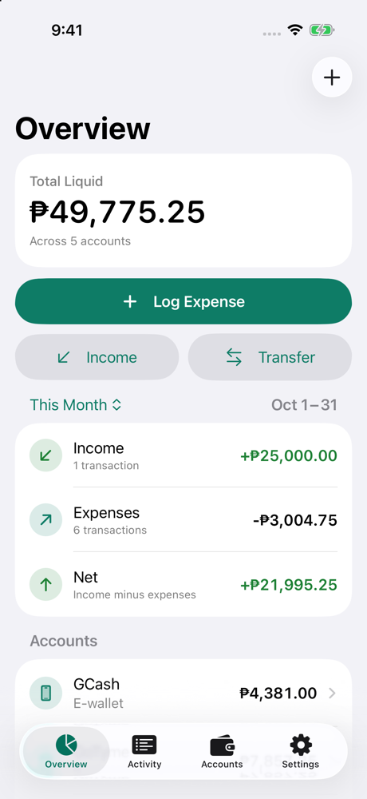
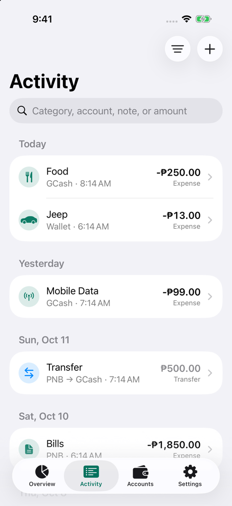
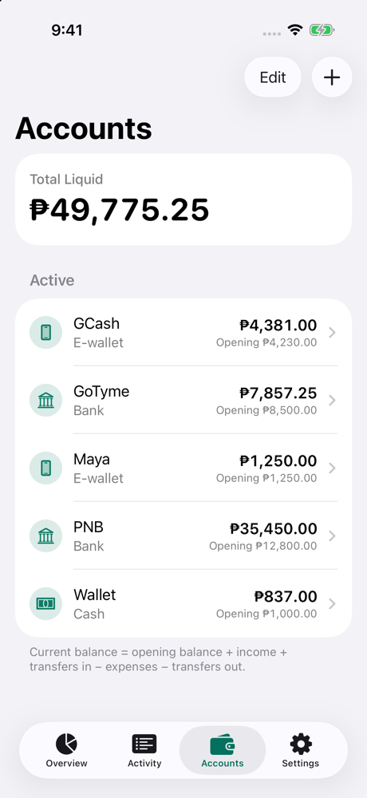
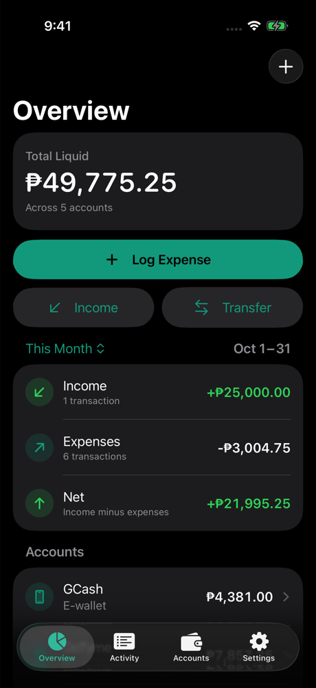
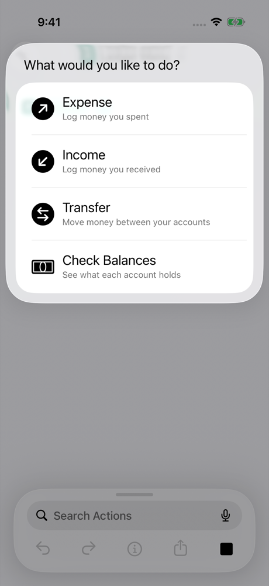
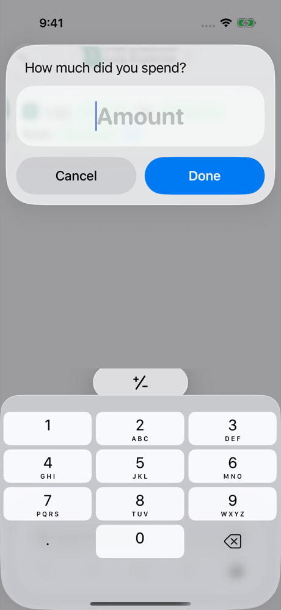
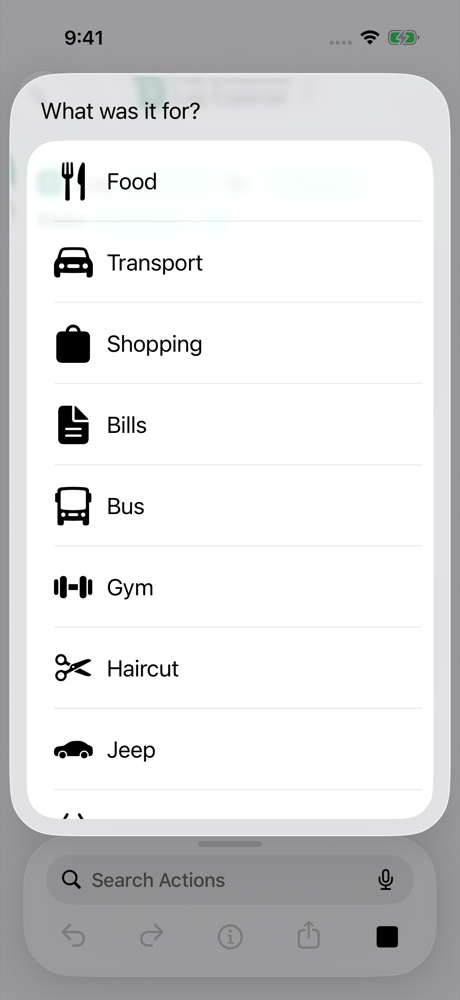
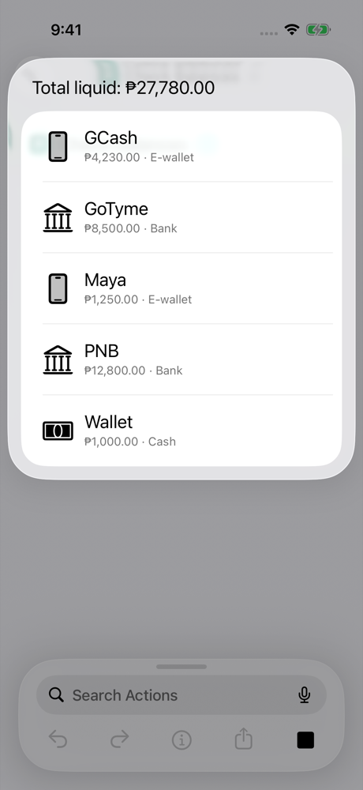

<p align="center">
  
</p>

<h1 align="center">Ledger</h1>

<p align="center">
  Log money in seconds with the iPhone Action Button.<br>
  A local-only personal finance app in Philippine pesos (₱).
</p>

<p align="center">
  
  
  
  <a href="LICENSE"></a>
</p>

<p align="center">
  
  
  
  
</p>

Press the Action Button, choose **Expense**, type **250**, pick **Food**, pick **GCash**, and the
expense is saved, without opening the app. Ledger keeps every balance exact and everything on your
iPhone.

## Features

- **Fast logging** from the Action Button, Shortcuts, Siri and Spotlight through App Intents.
  Ledger asks only for what's missing, in a fixed order: amount, category, account.
- **Balances you can trust.** Each balance is calculated from the opening balance you entered and
  the transactions you recorded. Nothing is guessed, and no separate counter can drift.
- **Exact money.** Amounts are stored as whole centavos and calculated with `Decimal`, never with
  binary floating point.
- **Expenses, income and transfers.** A transfer moves money between your own accounts, counts as
  neither income nor an expense, and is saved in one step so it can't be half-recorded.
- **Balance adjustments.** Type what an account really holds and Ledger records the difference
  as one adjustment. It changes the balance but never counts as income or spending.
- **Daily interest.** Give a savings account its annual rate and withholding tax, and Ledger adds
  each day's interest and tax at 1:00 AM the next day, as one row per day. If Ledger hasn't run
  for a while, it catches up on the missed days the next time it does.
- **Bills and debts.** A Bills tab keeps credit cards, pay later accounts, loans and regular
  bills apart from the money you have, with what's due next at the top. Log a card purchase like
  any expense; pay it with a transfer, which is never counted as spending.
- **Cashback, splits and loans.** Cashback is added to every purchase on a card that earns it.
  Split a pay later purchase into monthly payments, add a loan you're partway through, and see
  "6 of 12 paid" and what's left on each due.
- **Due reminders you can't miss.** On a due day, a Live Activity shows what's due in the
  Dynamic Island and on the Lock Screen, and keeps coming back until it's paid. Snooze it for an
  hour or three, move this month's due date, or tap **Paid** to open the payment. Prefer plain
  notifications? Turn strict reminders off in Settings or for any single bill. Reminders never
  show amounts.
- **Duplicate protection.** A double tap saves once, and an entry identical to one from the last
  two minutes asks before saving again.
- **Log from bank emails.** A Shortcuts automation can pass a bank's email to Ledger, which reads
  the amount and reference number and asks you to confirm.
- **Local only.** No sign-in, no server, no bank connection, no analytics, no network requests.
- **Apple frameworks only:** SwiftUI, SwiftData, App Intents and XCTest. No third-party code.

## The Action Button flow

| 1. Choose | 2. Amount | 3. Category | Result |
|:---:|:---:|:---:|:---:|
|  |  |  |  |

Results use the same list iOS draws for the menu, so they stay readable in light and dark
appearance over any background. Tap a row, or outside the list, to close it.

### Assign the Action Button

iOS reserves this setting for you, so Ledger can't set it up itself.

1. Install Ledger and open it once.
2. Open **Settings → Action Button** and swipe to **Shortcut**.
3. Tap **Choose a Shortcut**, find **Ledger**, and pick **Ledger Menu** (all five actions) or
   **Log Expense** (fastest for everyday spending).

The Action Button needs an iPhone 15 Pro or later. Everything else works on any iPhone running
iOS 26.

## Requirements

| | |
|---|---|
| Xcode | 27.0 or later (built with Xcode 27.0, the iOS 27 SDK and Swift 6.4) |
| iOS | 26.0 or later, iPhone only, portrait |
| Dependencies | None |

Ledger uses no iOS 27-only API. It builds with the iOS 27 SDK and runs on iOS 26 and later.

## Getting started

### Run in the simulator

Clone the repository, open `Ledger.xcodeproj`, choose the **Ledger** scheme and an iPhone
simulator, and press Run. From the command line:

```sh
xcodebuild -project Ledger.xcodeproj -scheme Ledger \
  -destination 'platform=iOS Simulator,name=iPhone 17 Pro' build
```

### Run on your iPhone

1. Select the **Ledger** target → **Signing & Capabilities** and choose your own **Team** (a free
   Apple ID works). The project file contains the author's team, which you can't sign with.
2. Change the **Bundle Identifier** from `ph.personal.Ledger` to one of your own, for example
   `com.yourname.ledger`. Do this before the first install: App Shortcuts and your Action Button
   assignment are tied to it.
3. On the iPhone, turn on **Settings → Privacy & Security → Developer Mode** if asked.
4. Select the iPhone as the run destination and press Run.

With a free Apple ID, the installed app stops launching after 7 days until you run it from Xcode
again. Installing over the existing app keeps your data. **Deleting the app deletes its data.**

## Shortcuts and Siri

Ledger's App Shortcuts appear automatically once the app has been opened. There's nothing to build
in the Shortcuts app.

| Shortcut | What it does | Example Siri phrase |
|---|---|---|
| **Ledger Menu** | Choose Expense, Income, Transfer, Check Balances or Update Balance, then continue | "Ledger menu" |
| **Log Expense** | Amount → category → account → saved | "Log an expense in Ledger" |
| **Log Income** | Amount → income source → account → saved | "Log income in Ledger" |
| **Transfer Money** | Amount → from → to → confirm → saved | "Transfer money in Ledger" |
| **Check Balances** | Each active account and the total liquid balance (read-only) | "Check my Ledger balances" |

- **Confirmation** is always asked for transfers and balance updates. For expenses and income
  it's asked only when the entry repeats one from the last two minutes or is ₱100,000 or more.
- **Update Balance** asks for the account, then its real balance. Because Shortcuts sends 0 for an
  empty amount, a real balance of exactly ₱0 has to be entered in the app.
- **Cancelling** at any step saves nothing. An invalid amount (zero, or more than two decimals) is
  asked for again with the reason.
- **Locked iPhone:** iOS asks for Face ID or the passcode first, because the actions read or
  change financial data.
- **Custom shortcuts:** in Log Expense, Log Income and Transfer Money every value is an optional
  parameter, so a shortcut can supply some or all of them. For example, "Log Expense ₱13, Jeep,
  Wallet" runs with no questions at all.
- **Siri** speaks the full result and then, as with any list, asks you to pick a row. Say
  "Cancel" to close it.

### Log from bank emails

iOS doesn't let apps read other apps' notifications, so Ledger can't watch GCash or MariBank
alerts. Banks that **email** each transaction can still feed Ledger through a Shortcuts
automation and the **Log From Message** action:

1. Make sure the bank's emails arrive in Apple's **Mail** app. Automations can't see the Gmail or
   Outlook apps.
2. In Shortcuts, go to **Automation → + → Email** and set **Sender** to the bank's address.
3. Choose **Run Immediately**.
4. Add **Log From Message**. Set **Message** to **Shortcut Input** and **Account** to that bank's
   account in Ledger.

When an email arrives, Ledger reads it on the device: the amount (ignoring balances and limits),
whether money went out or came in, and the reference number. It asks for anything it couldn't
read, asks for the category, and **always asks before saving**. An email whose reference number
was already logged is flagged, so a repeated alert isn't recorded twice. Each bank words its
emails differently, so check the first few entries.

## How it works

### One ledger engine

`LedgerService` is the only code that changes financial data or calculates balances. The SwiftUI
screens and the App Intents both use it, so a shortcut and the app apply identical validation and
arithmetic. Views never modify models directly.

Every change is saved before the call returns. If saving fails, the pending changes are rolled
back, already-loaded objects are refreshed to their saved values, and an error is shown, never a
success message.

### Money

- Amounts are positive `Decimal` values with at most two decimal places, up to
  ₱999,999,999,999.99. The transaction type decides the direction.
- They're stored as exact whole centavos (`Int64`). Conversions refuse, rather than round,
  anything that isn't exact.
- Shortcuts' amount prompt is a number field, which opens with the decimal pad ready. Its value is
  converted to `Decimal` through its shortest decimal text, so 19.99 stays 19.99.
- Display settings: symbol (₱1,234.50) or code (PHP 1,234.50); centavos always or only when needed.

### Balances

```
current balance = opening balance + income + transfers in − expenses − transfers out ± adjustments
```

- An account whose opening balance hasn't been entered has **no** current balance. Ledger shows
  "Not set" instead of ₱0 and leaves the account out of the total liquid balance, naming it.
- The opening balance is what the account held before the first transaction you record in Ledger.
  Onboarding asks what each account holds **now** and works out the opening balance, so entries
  logged earlier aren't counted twice.
- Archived accounts keep their history but are left out of the total liquid balance.
- **Update Balance** compares the real balance you type with Ledger's and records one adjustment
  for the difference. Adjustments are left out of income, spending and net totals. For an account
  with no opening balance yet, it sets the opening balance instead.

### Daily interest

```
interest = day's ending balance × annual rate ÷ 360, rounded up to the centavo
tax      = interest × withholding tax rate (20% by default), rounded to the nearest centavo
```

- Each day's interest and tax are recorded as two entries dated 1:00 AM the next day, the way
  banks credit them, so each day's interest earns interest from the next day on. Lists show them
  as one row, and tapping it shows the balance, rate, interest and tax for each account.
- Ledger has no server, so it posts interest when it runs: when the app comes to the foreground,
  at 1:00 AM while it's open, and before any shortcut reads or changes data. Missed days are
  posted in order, in one save, and never twice.
- Interest starts the day it's turned on. A rate change applies to every day not yet posted, and
  days with an unknown, zero or negative balance earn nothing. Posted interest stays as it is,
  even if an earlier entry is logged later; the next Update Balance absorbs the difference.
- The formula was inferred from one bank's statements. If yours rounds differently, Update Balance
  brings the account back in line.

### Bills and debts

```
left on a due = what's owed now − charges billed after its statement − plan payments due later
```

- Credit cards, pay later accounts and loans are accounts whose balance is what you owe. They're
  left out of the total liquid balance and shown in the Bills tab, which adds them up as
  **Total You Owe**. Setting one up asks for the total you owe now and, when a statement has
  already closed, what's still due on it.
- Nothing about a payment is stored separately: any transfer into the account counts toward its
  due as soon as it's logged, including from the Action Button. A due that passes unpaid is
  marked overdue, and what's left carries into the next one.
- Cashback is a percentage of each purchase, rounded down to the centavo, recorded with the
  purchase and kept in step when it's edited or deleted. It counts as income.
- A split or loan is a plan of monthly payments on the account's due dates. A new one records the
  price as spending in its category and any extra as fees and interest; one already under way
  records nothing new. Months paid follow the dues, so one payment never counts for two plans.
- Regular bills (rent, internet, electricity) have a due day and a fixed or varying amount.
  **Paid** records the payment as an expense in the bill's category. One month's due can be moved
  without changing the others.

### Reminders

- Every unpaid due gets a notification the day before, at the reminder time (9:00 AM unless you
  change it in Settings). A bill whose amount varies also gets "Check if your bill came in" each
  day from its usual arrival day until you enter the amount.
- **Strict reminders** (on by default, in Settings and on each bill or debt): from the due day,
  a Live Activity lists everything due or overdue. It starts at the reminder time and again eight
  hours later, because iOS ends Live Activities after about eight hours, and it shows as soon as
  you open Ledger. **Snooze** hides it for 1 or 3 hours; **Move** changes this month's due date;
  **Paid** opens the prefilled payment, and nothing is paid until you save it.
- With strict reminders off, or Live Activities turned off for Ledger, you get one notification on
  the due day and each overdue day instead.
- Everything is scheduled on the iPhone; there's no server. iOS lets an app line up a Live Activity
  only while it runs, so Ledger reschedules every time it opens or a shortcut runs.

### Accounts and categories

First launch creates the accounts GCash, GoTyme, Maya, PNB and Wallet; the expense categories
Food, Transport, Shopping, Bills, Bus, Gym, Haircut, Jeep, Marketing and Mobile Data; and the
income sources Salary, Other income, Refund and Bonus. Opening balances start unset. Everything
can be renamed, reordered, added or archived. Anything used by a transaction can only be archived,
so history stays intact.

## Privacy

Your data stays in a SwiftData store inside the app's private container, protected by iOS Data
Protection. Ledger makes no network requests, has no analytics, and its logs never contain amounts,
balances, names or notes. The data is included in your iCloud or computer backup when those are
turned on; there's no other copy. See [PRIVACY.md](PRIVACY.md).

The schema is versioned with a migration plan: future changes add a new version and carry existing
records forward. If the store can't be opened, the app shows an error and deletes nothing.

Ledger hasn't been independently security audited.

## Testing

```sh
xcodebuild -project Ledger.xcodeproj -scheme Ledger \
  -destination 'platform=iOS Simulator,name=iPhone 17 Pro' test
```

379 unit tests run against isolated in-memory stores with fixed clocks and synthetic data, never
real data. They cover balances after every kind of change, transfers, edits and deletes, failed
saves, exact arithmetic, archiving, duplicate protection, unset opening balances, balance
adjustments, daily interest and its catch-up, billing cycles and dues, cashback, payment plans,
regular bills, reminder planning (strict and plain, snoozes, moved and overdue dues), the schema
migrations, amount parsing and formatting, the bank-email reader, and the App Intent flows.

The optional **LedgerShortcutsUITests** scheme drives Apple's Shortcuts app in the simulator. It
checks that the App Shortcuts are registered, runs Check Balances, walks the prompts, cancels
midway, and checks that amounts stay exact. iOS only shows category and account lists to apps
signed with a development team, so without one those steps are skipped with an explanation. Set
your team on the Ledger and LedgerUITests targets to run them in full. The tests depend on the
Shortcuts app's layout, so an iOS update can break them without anything being wrong in Ledger.

## Project structure

```
Ledger/
  App/            Entry point, tabs, launch configuration, store-failure screen
  Domain/         Money and currency, kinds of transactions, accounts and categories, errors
  Persistence/    SwiftData schema (versioned), migration plan, store, seed data
  Services/       LedgerService, BalanceCalculator, reporting periods, bank-email reader
  Formatting/     Money formatting, amount parsing, display and app preferences
  Components/     Shared SwiftUI views and navigation
  Features/       Screens: Overview, Activity, Accounts, Bills, Onboarding, Settings
  Intents/        App Intents, entities, App Shortcuts, intent flows, result list
  Reminders/      Reminder planning, notifications, Live Activity scheduling
  Support/        Logging; Debug-only sample data for previews and screenshots
  Resources/      Asset catalog
LedgerShared/     Live Activity attributes, reminder wording and button intents (app and widget)
LedgerWidgets/    Widget extension that draws the due reminder Live Activity
LedgerTests/      Unit tests
LedgerUITests/    Optional UI tests that drive the Shortcuts app (separate scheme)
scripts/          App icon generator, SF Symbol checker, simulator screenshot helper
docs/images/      README images
```

### Debug launch arguments

Debug builds accept these arguments (scheme → Run → Arguments, or `xcrun simctl launch`). Release
builds ignore them.

| Argument | Effect |
|---|---|
| `-LedgerInMemoryStore YES` | Use a throwaway in-memory store; the real store is untouched |
| `-LedgerSampleData YES` | With the in-memory store, add sample records |
| `-LedgerSkipOnboarding YES` | Start on the tabs |
| `-LedgerInitialTab dashboard\|transactions\|accounts\|bills\|settings` | Open a specific tab |
| `-LedgerOpenEditor expense\|income\|transfer` | Open the transaction editor on launch |

`scripts/screenshot.sh` installs a build on a simulator, launches it with such arguments, and saves
a screenshot. `scripts/check_sf_symbols.py` checks every SF Symbol name used in the code.

## Status

Ledger is a working prototype, version 0.1.0. See [PROJECT_STATUS.md](PROJECT_STATUS.md) for
what has been verified where.

| Area | Status |
|---|---|
| Ledger engine | Unit-tested; all tests pass |
| App screens | Run and checked in light mode, dark mode and large text |
| Ledger Menu, Log Expense and Check Balances on an iPhone | Run on an iPhone 16 Pro |
| Result list | Checked in the simulator in light and dark |
| Balance adjustments and daily interest | Unit-tested; screens checked in the simulator in light and dark; not yet run on an iPhone |
| Bills and debts | Unit-tested; screens checked in the simulator in light and dark; not yet run on an iPhone |
| Due reminders | Unit-tested; notifications, the Dynamic Island, the Lock Screen Live Activity and its Paid button checked in the simulator in light and dark; not yet run on an iPhone |
| Log Income, Transfer Money, Log From Message on a device | Not tried yet; covered by unit tests that drive the same flow code |

**Limitations:** one currency (PHP); no export, import or sync; no Home Screen widgets or Apple
Watch app, though the due reminder Live Activity shows in the Smart Stack; iPhone only, portrait.

**Not built yet, with room left in the data model:** budgets, pay-period tracking and
projections, recurring obligations, reserved funds and emergency-fund tracking, advanced
analytics, multi-currency, bank sync, cloud sync, export, and stronger at-rest encryption.

## Contributing

Issues and pull requests are welcome. See [CONTRIBUTING.md](CONTRIBUTING.md). Ledger stays
local-only, so changes that add network access, analytics or third-party dependencies won't be
merged.

## Credits

Vibe coded with [Claude Code](https://claude.com/claude-code) by **Eugene Clark Eridao**
(@yowjin.dev).

Claude and Claude Code are trademarks of Anthropic. Ledger isn't affiliated with or endorsed by
Anthropic. The animated spark on the credits screen is drawn in code; it isn't Anthropic's logo.

## License

Ledger is released under the [MIT License](LICENSE).
